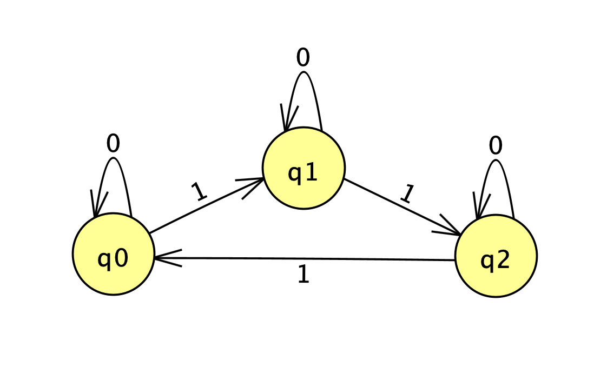
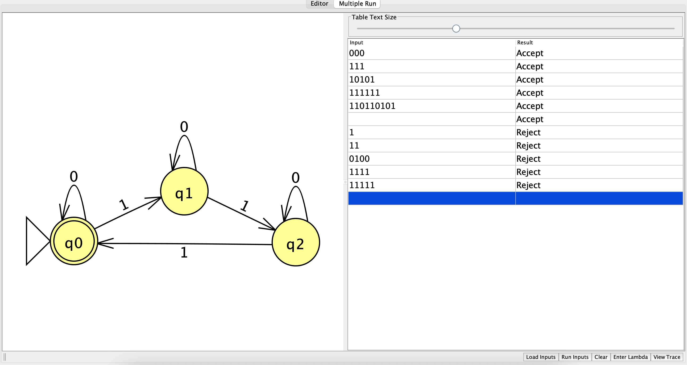
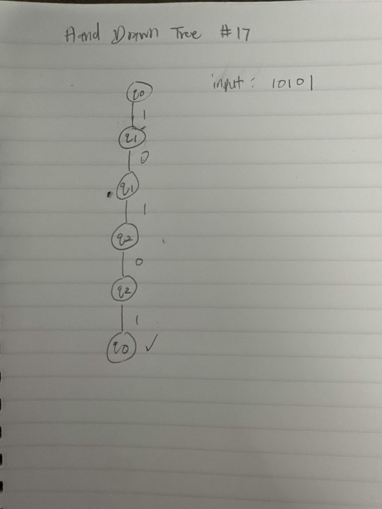
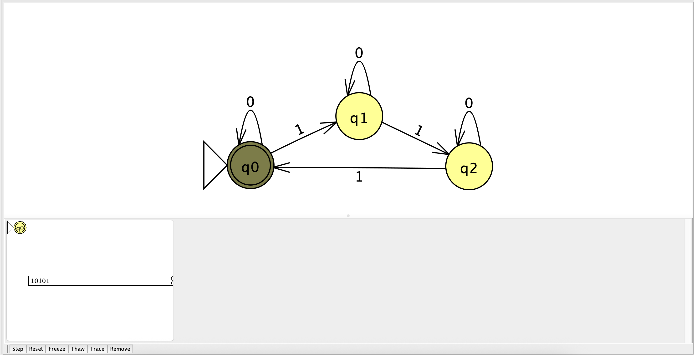
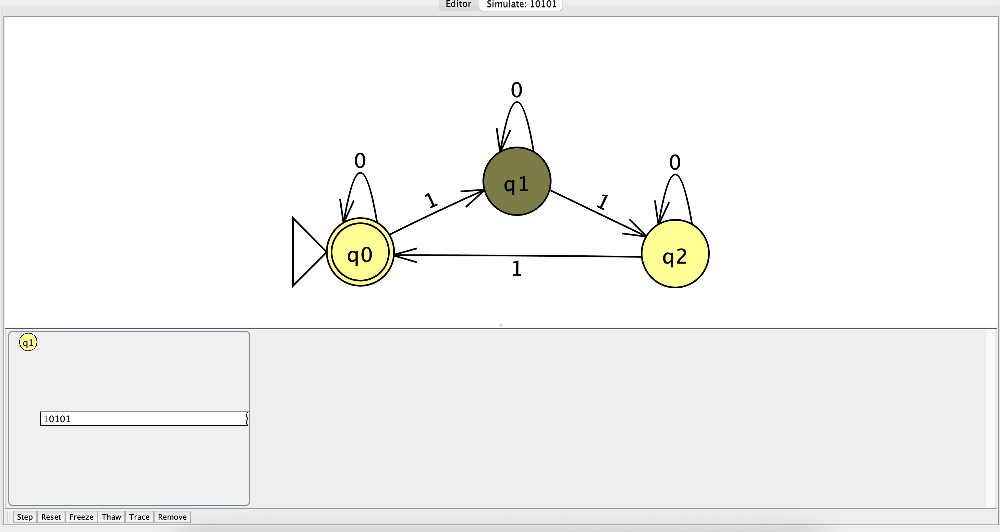
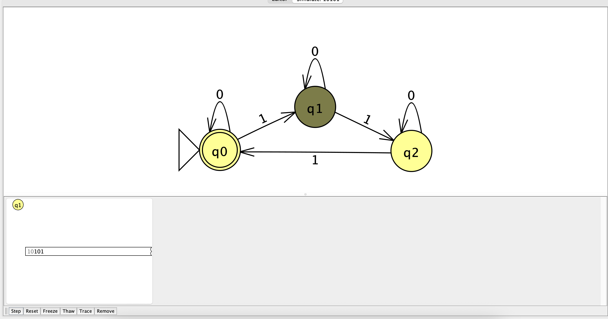
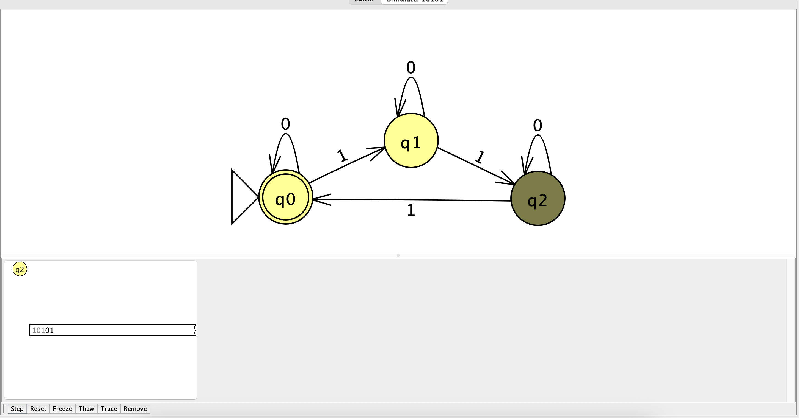
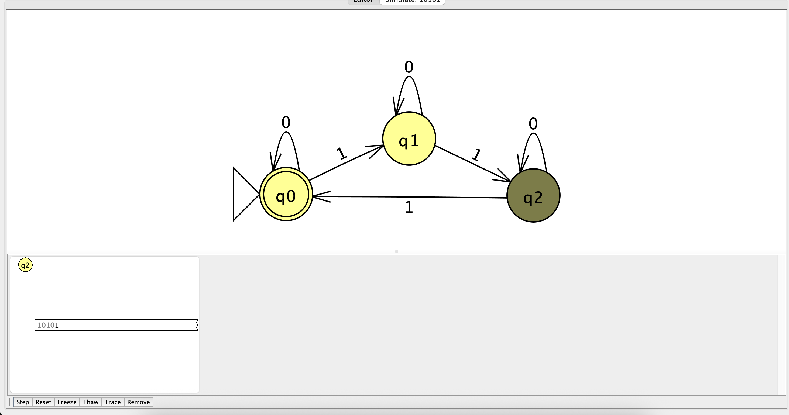
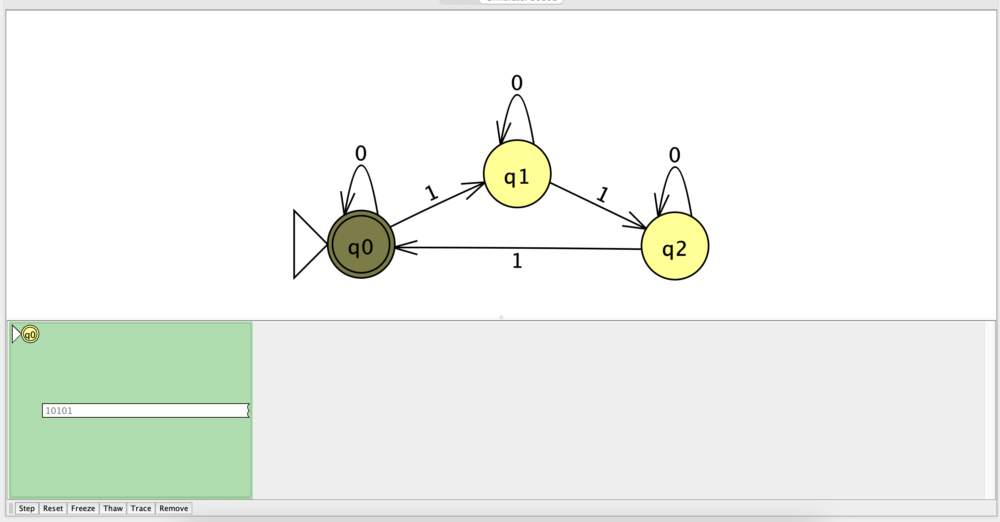

# NFA Problem #17

# NFA Design

# NFA Batch run

# NFA hand drawn tree (input : 10101)

# NFA Step-by-Step state transitions (input : 10101)
## Start

## Step 1

## Step 2

## Step 3

## Step 4

## Step 5 (input accepted)
